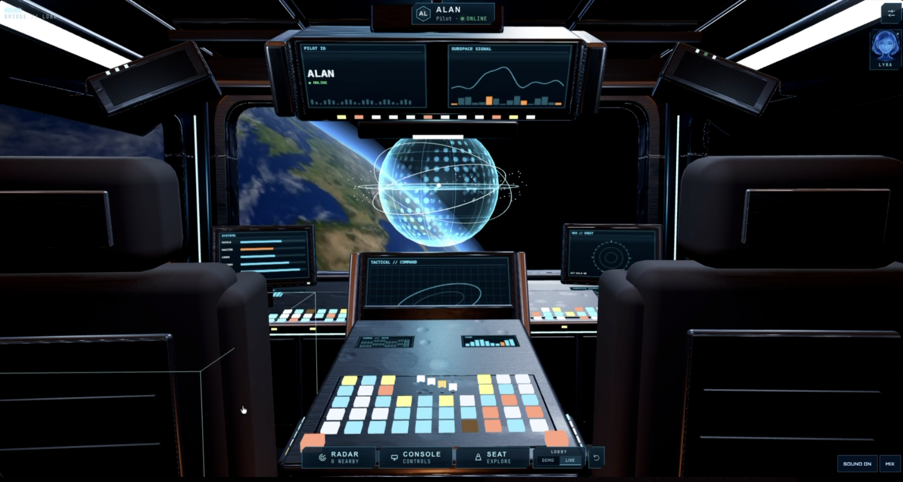
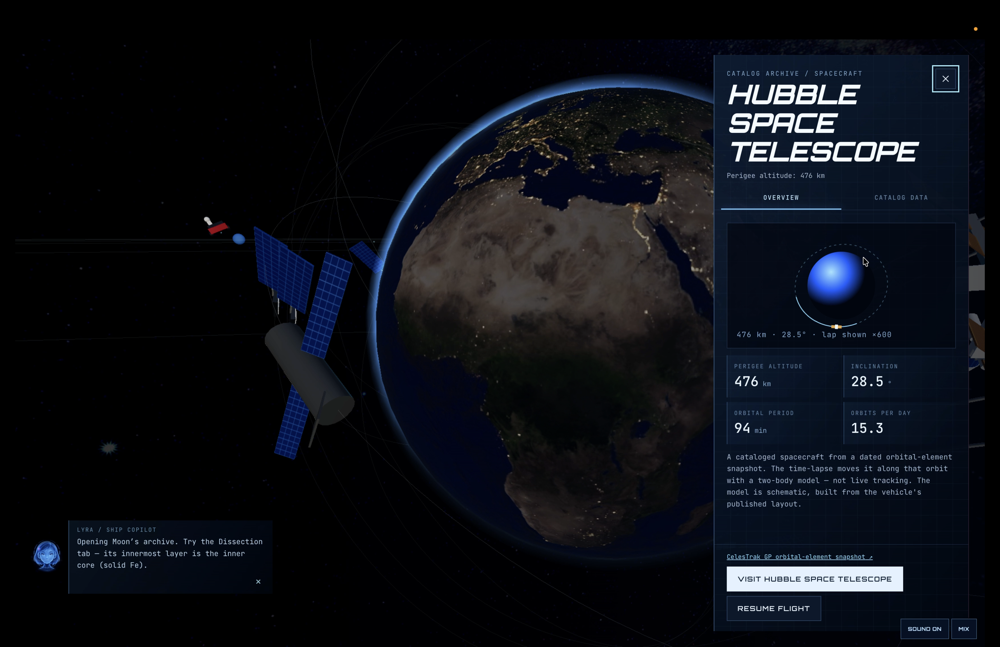
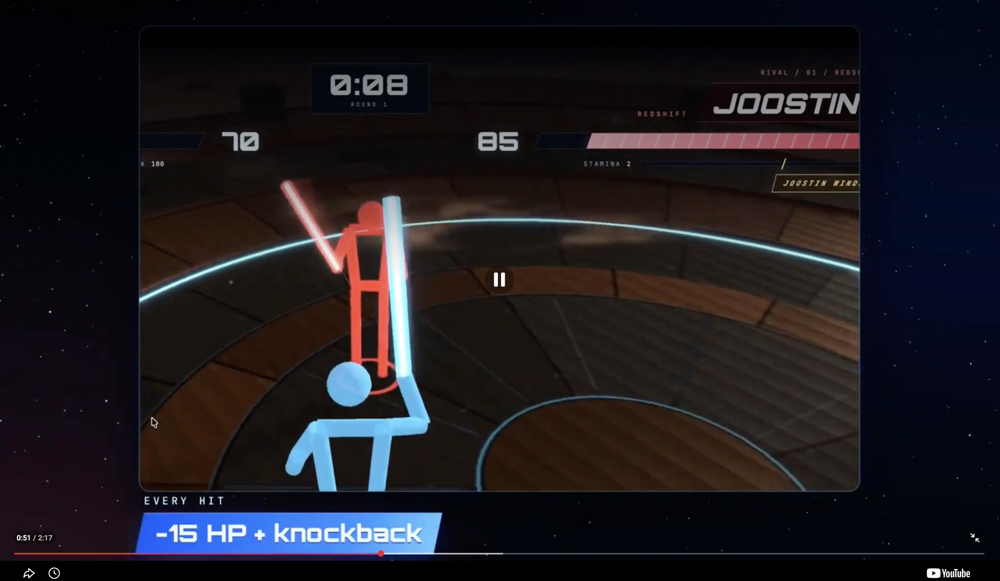
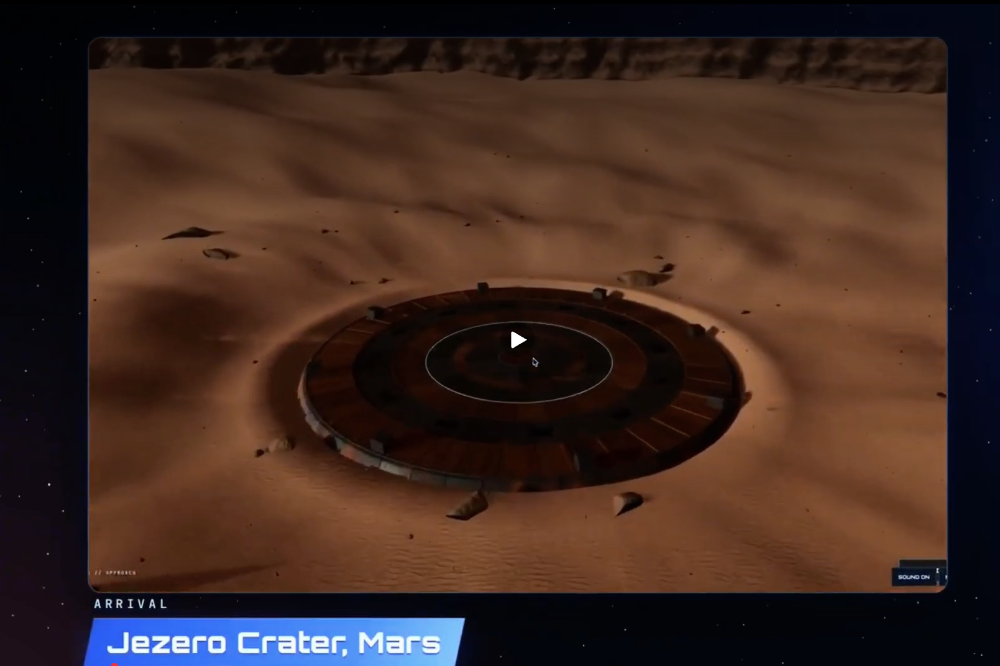

<h1 align="center">KO.rbit</h1>

<p align="center"><b>Fly a starship through 31,266 real astronomical objects, then land on Mars and fight a rival in a lightsaber duel, using your body as the controller and your phone as the saber.</b></p>

<p align="center">
  <a href="https://devpost.com/software/space-battles-aei3wz"></a>
</p>

<p align="center">
  <a href="https://devpost.com/software/space-battles-aei3wz">Devpost</a> ·
  <a href="https://www.youtube.com/watch?v=Ta64tj6uJc4">Demo video</a> ·
  <a href="#run-locally">Run locally</a> ·
  <a href="https://github.com/dubhack26/KO.rbit">Source</a>
</p>

<p align="center">
  
  
  
  
  
  
  
  
</p>

<p align="center">
  
  
</p>
<p align="center">
  
  
</p>

## Why it's cool

KO.rbit is a real-time, two-player lightsaber duel with no controller. A laptop webcam tracks your full body with MediaPipe Pose, and your phone's motion sensors become the saber. Every swing, block, and step streams to a Node/Socket.IO server that decides each hit, so nobody can win by spoofing their camera feed. Before the fight, you fly a 3D cockpit through 31,266 real stars, exoplanets, galaxies, satellites, and SpaceX spacecraft, guided by LYRA, a voice copilot built on xAI's Grok Voice. Then planetary roulette sends you to Mars or Neptune, where the Mars arena is carved from NASA MOLA elevation data for Jezero Crater and the Neptune arena is modeled on its real atmosphere, since Neptune has no solid ground. We built it in about 24 hours at DubHacks 2026.

> **Live demo:** there is no permanent hosted URL. The game runs locally, and multiplayer/phone play is shared through a temporary Cloudflare tunnel opened for each session (see [Run locally](#run-locally)).

## Highlights

- **31,266 real objects** from HYG, NASA Exoplanet Archive, NED, NASA fact sheets, CelesTrak, and JPL, each with a searchable fact card.
- **Server-authoritative combat:** a 33 ms tick with 10 substeps, so fast swings can't pass through a guard.
- **Body + phone input:** pose streams at about 30 Hz (`BODY_SEND_MS = 33`) and saber aim at about 60 Hz (`AIM_SEND_MS = 16`). WASD and arrow keys work as a fallback.
- **Fighting mechanics:** 100 HP, 15 damage per hit with 0.65 m knockback, stamina-limited steps, guard breaks and stuns, rematches, and a 15 s reconnect grace.
- **Voice AI copilot:** Grok Voice realtime sessions using 60-second client secrets minted on the server.
- **Real terrain:** a 256×256 NASA MOLA crop of Jezero Crater, plus a cinematic KO replay that picks highlights with Perceptron Mk1.5 (opt-in, with consent at both the recording and upload steps).
- **339 passing tests:** 121 server (`node --test`) and 218 web (Vitest).

## What it does

1. **Commission a pilot.** An animated onboarding flow sets your callsign and ship, then a hyperspace jump drops you into a 3D cockpit.
2. **Explore a real universe.** Fly freely, search, jump to any catalogued object, and read its fact card. Time-lapse runs at 1×, 60×, or 600×.
3. **Challenge a rival.** Pick an online pilot from the cockpit radar. The server handles the lobby, invitations, and readiness.
4. **Planetary roulette.** The roulette spins through a 3D solar system and the server picks your destination world. A live 3D animation hands off to a travel cinematic made with Grok Imagine, then cuts back into the live 3D scene as you enter the arena. For the hackathon demo, Mars and Neptune are the two playable arenas.
5. **Duel with your body.** Pair your phone by QR code, hold to ignite, swing to strike, hold a guard to block, and swipe to step or circle.
6. **Relive the KO.** Opt in to record a short local clip (up to 45 s). Perceptron picks the highlight intervals, and the replay always ends on the server-confirmed finishing blow.

## Engineering highlights

| Area | What we built | Where |
|---|---|---|
| **Authoritative netcode** | The server owns health, stamina, cooldowns, hits, blocks, and the winner. Clients send commands with IDs and acknowledgements. Pose frames are sent as sequence-numbered volatile Socket.IO messages. The server parses each one, drops stale or too-frequent frames, and treats poses as inputs rather than proof. Blade collisions are checked across 10 substeps per 33 ms tick. | `server/src/game/rules.ts`, `match.ts`, `saber3d.ts`, `web/src/networking/gameClient.ts` |
| **Secrets stay server-side** | The server exchanges the permanent xAI key for a 60-second realtime client secret, so the browser never sees the real key. LYRA has a single read-only tool (`getFlightState`) and cannot change the lobby or match state. | `server/src/integrations/copilot.ts`, `server/src/integrations/grok/` |
| **Pose pipeline** | MediaPipe `PoseLandmarker` (full model, VIDEO mode) runs on the GPU and falls back to the CPU. Landmarks become a body stream that drives both the on-screen fighter and the server's body/blade geometry (`server/src/game/saber3d.ts`). | `web/src/arena3d/ArenaDuel.tsx`, `web/src/camera/mediapipeVision.ts` |
| **Phone as saber** | The phone page reads `deviceorientation` for aim and `devicemotion` for swings over HTTPS. It pairs with the laptop by QR code. | `web/src/saber/SaberPhone.tsx`, `aimMath.ts` |
| **3D rendering** | React Three Fiber scenes for the cockpit, explore universe, and arenas, with drei helpers and postprocessing. | `web/src/three/`, `web/src/arena3d/`, `web/src/arena/` |
| **Video-to-3D handoff** | Travel cinematics generated with Grok Imagine are matched to the live scenes, so the animation flows from real-time 3D into video and back into 3D at arena entry without a visible cut. | `web/src/ui/cinematics/PlanetaryTransition.tsx`, `web/src/arena/neptune/NeptuneArrival.tsx` |
| **Data pipelines** | Python importers build dated, attributed catalogs at build time, with a validator. Orbits use a two-body Kepler solver. | `web/scripts/import-*.py`, `validate-universe.py`, `scripts/mars/crop_mola.py` |
| **Testing** | 121 server tests (rules, match flow and reconnects, saber geometry, sessions, replay, copilot) and 218 web tests. | `server/src/**/*.test.ts`, `web/src/**/*.test.ts` |

## Real space data

| Data | Source | Count |
|---|---|---|
| Stars | HYG Database v4.1 (CC BY-SA 4.0) | 24,835 |
| Exoplanets | NASA Exoplanet Archive (PSCompPars) | 5,301 around 3,894 hosts |
| Galaxies | GALEX Ultraviolet Atlas via NASA/IPAC NED | 1,034 |
| Planets + Moon | NASA Planetary Fact Sheets | 9 |
| Satellites | CelesTrak (ISS, Hubble) + Starlink TLEs | 20 |
| Asteroids & comets | NASA/JPL Small-Body Database API | 60 |
| SpaceX spacecraft | CelesTrak + JPL Horizons orbital elements | 7 |
| Mars arena terrain | NASA PDS `MGS-M-MOLA-5-MEGDR-L3-V1.0` (Jezero Crater, 256×256 crop) | — |

The data is imported at build time by `web/scripts/import-universe.py`, `import-local-objects.py`, `import-spacex.py`, and `scripts/mars/crop_mola.py`. The results are dated snapshots (2026-10-18), not live feeds. Orbits use a two-body Kepler solver on published orbital elements, not live tracking, and satellite altitudes are exaggerated for visibility. Each world shows its surface gravity from the NASA fact sheet, but **gravity does not affect combat yet**. Full attribution lives in `web/public/arena/mars/ATTRIBUTION.md`, `web/public/textures/planets/ATTRIBUTION.md`, and `datasets.md`.

### How the planetary arenas were built

- **Mars (Jezero Crater).** The arena terrain comes from NASA's Mars Orbiter Laser Altimeter (MOLA) elevation data. `scripts/mars/crop_mola.py` crops a region about 148 km across around Jezero Crater and resamples it into a 256×256, 16-bit heightmap. Procedural detail and photo-scanned rock and sand textures, re-graded toward Mars tones, are layered on top, and gravity comes from the NASA Mars Fact Sheet.
- **Neptune.** Neptune has no solid surface, so the duel takes place on a fictional platform above the clouds, and the scene is built around its real atmosphere. Its reference values come from the NASA Neptune Fact Sheet: gravity at the 1-bar level, temperature, hydrogen, helium, and methane composition, and top wind speeds of 580 m/s. Observations from NASA Science and Voyager 2 shape the procedural sky: methane's blue color, bright methane cirrus over a darker cloud deck, banded winds, and sunlight about 1/900 as bright as Earth's. Sources are listed in `docs/neptune-sources.md` and `web/src/arena/neptune/neptuneConfig.ts`.

## Tech stack

| Layer | Technologies |
|---|---|
| Client | React 19, TypeScript, Vite 7, Three.js, React Three Fiber / drei / postprocessing, Motion |
| Body tracking & saber | MediaPipe Tasks Vision (Pose) on the laptop; phone motion sensors over HTTPS; QR pairing |
| Server | Node.js 22, TypeScript, Socket.IO 4.8 |
| AI | xAI Grok Voice (realtime) and Grok TTS for LYRA; Perceptron Mk1.5 for replay highlights |
| Data | NASA, JPL, CelesTrak, HYG catalogs (Python importers) |
| Testing | Vitest (web), `node --test` (server) |

## Architecture

```text
 Laptop browser (React + Three.js)            Phone browser (/?saber=CODE)
 ├─ Cockpit, Explore, Arena scenes             └─ Saber controller: aim, swing, swipe-to-step
 ├─ MediaPipe Pose → body stream                         │
 └─ LYRA voice UI ─┐                                     │
        │          │ short-lived client secret           │
        │          ▼                                     │
        │     xAI Grok Voice / TTS                       │
        ▼                                                ▼
 ┌──────────────────── Socket.IO (via Vite proxy /socket.io) ───────────────────┐
 │ server/ (Node, port 3001)                                                     │
 │  sessions/  lobby, identities, challenges   game/  saber match, rules, tick   │
 │  integrations/  copilot token minting, LYRA narration, Perceptron replay      │
 └──────────────────────────────────────────────────────────────────────────────┘
```

The server owns health, stamina, hits, blocks, cooldowns, and the winner. Clients only send commands.

## Run locally

**Requirements**
- Node.js **22+** (`server/package.json` sets `engines.node >= 22`)
- To play a real duel, each player needs a laptop with a webcam and a phone with motion sensors. iOS only allows motion access on **HTTPS** pages.
- Optional API keys: xAI (for LYRA) and Perceptron (for replays). The game, dev routes, and tests all run without keys. When no key is set, LYRA falls back to a labeled local demo guide.

**0. Clone**
```bash
git clone https://github.com/dubhack26/KO.rbit.git
cd KO.rbit
```

**1. Game server** (terminal 1)
```bash
cd server
npm ci
npm run dev          # tsc --watch + node --watch on http://localhost:3001  (GET /health → ok)
```

**2. Web client** (terminal 2)
```bash
cd web
npm ci
npm run dev          # https://localhost:5173 (self-signed cert; accept the warning)
```
Vite proxies `/socket.io` and `/replay` to the game server.

**3. Phone saber / sharing a live demo**: expose the Vite server over a public HTTPS tunnel, then scan the pair QR code shown on the laptop:
```bash
npx --yes cloudflared tunnel --url https://localhost:5173
# or: ngrok http https://localhost:5173
```

**Environment variables** (names only; never commit values)

| Where | Variable | Purpose |
|---|---|---|
| `server/.env.grok.local` (template: `.env.grok.local.example`) | `XAI_API_KEY` | Grok Voice / TTS for LYRA |
| `server/.env` (template: `.env.perceptron.example`) | `PERCEPTRON_API_KEY`, `PERCEPTRON_MODEL` (default `perceptron-mk1.5`) | KO replay highlights |
| `server/.env` | `PORT` (default 3001), `ALLOWED_ORIGIN` (default `http://localhost:5173,https://localhost:5173`) | Server config |
| `web/.env.local` (template: `web/.env.example`) | `VITE_GAME_SERVER_URL`, `VITE_SABER_CONTROLLER_URL` | Point the client and phone links at a shared hosted server/tunnel; leave blank for local |
| shell (Vite) | `GAME_PROXY_TARGET` | Override the proxy target (default `http://127.0.0.1:3001`) |

**Dev / preview routes** (no second player needed)

| Route | What it shows |
|---|---|
| `/` | Onboarding → cockpit (Demo/Live switch) |
| `/?explore` | Free-flight universe explorer |
| `/?dev=arena` | Saber arena with synthetic fighters (no camera, phone or server) |
| `/?arena=mars` · `/?arena=neptune` | Arena scenes only |
| `/?journey=mars` | Mars travel sequence |
| `/?dev=replay` | Replay director with labeled synthetic footage |
| `/?dev=hud` | Scripted duel HUD |
| `/?audio=check` | Sound check |

**Tests and build**
```bash
cd server && npm test              # builds, then runs node --test (121 tests; the dist/**/*.test.js glob needs Node 22+)
cd web && npm test && npm run build  # Vitest (218 tests) + production build
```

## Team

| Member | Focus |
|---|---|
| Ally Chen ([@allyytc](https://github.com/allyytc)) | UI and animations, avatar creation, planetary scene development from real data, cockpit lobby, battle HUD |
| Justin Lee ([@just1nlee](https://github.com/just1nlee)) | Game server, lobby, lightsaber combat, networking |
| Alan Nguyen ([@alnnguyen](https://github.com/alnnguyen)) | Camera and gesture tracking, free-flight exploration, Perceptron replays |
| Alex Nguyen ([@alwxngn](https://github.com/alwxngn)) | UI and animations, LYRA voice copilot (Grok Voice), integrations, phone saber HUD, audio |

<!-- TODO(Ally): confirm teammate roles before publishing. -->

## Challenges

- **A mid-hackathon pivot.** We started with a gesture-based rock-and-blaster duel and switched to the phone saber, which forced the team to merge two diverging combat lines.
- **Contract drift.** The planned shared `packages/contracts` package was never filled in. Branches edited the server's types directly, and keeping clients wire-compatible took deliberate effort.
- **HTTPS everywhere.** Phone motion sensors require secure pages, so development ran on self-signed certificates and Cloudflare/ngrok tunnels whose hostnames kept changing.
- **Replay reliability.** Stopping the recorder without flushing produced empty files. Fixing it took recorder work and a new results layout.

## What we learned

- If camera input is treated as a request to the server rather than as truth, fights are fairer and easier to debug.
- Agree on shared contracts in the first hour.
- Real data needs provenance, so we keep attribution and manifests next to every dataset.
- Short-lived tokens and read-only tools keep an AI copilot safe.

## What's next

- Add more planets and arenas to explore beyond Mars and Neptune.
- Make each world's gravity change how combat feels.
- Run full QA on recorded duels and phone browsers, including a complete two-laptop, two-phone test.
- Richer live-duel hit effects (sparks, shockwave rings, hit-stop, a victory camera).

## Credits

Planet textures: Solar System Scope (CC BY 4.0). Ground materials: ambientCG (CC0). Star catalog: HYG Database (CC BY-SA 4.0). NASA/JPL data is in the public domain. See the `ATTRIBUTION.md` files and `datasets.md` for the full list. Built for DubHacks 2026 with help from Cursor and Grok Bot (planning, research, and sound design).

<!-- Internal hackathon process docs (PLAN.md, AGENTS.md, docs/task-board.md, sponsor evidence) are kept in the repo for reference. -->
